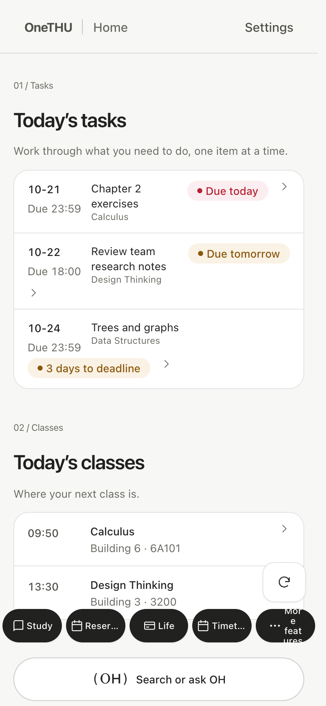
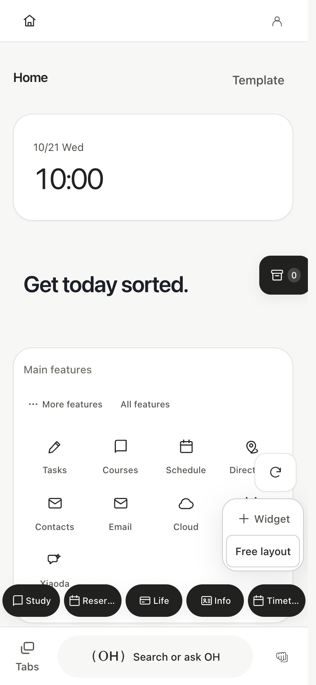
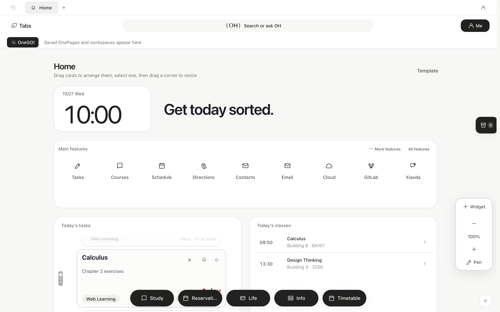
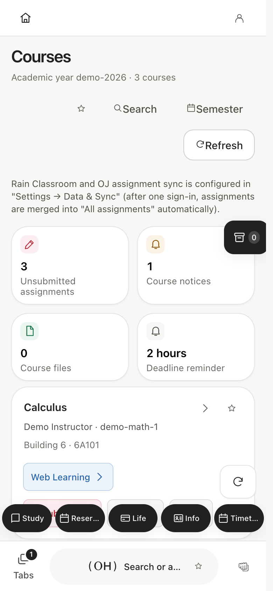
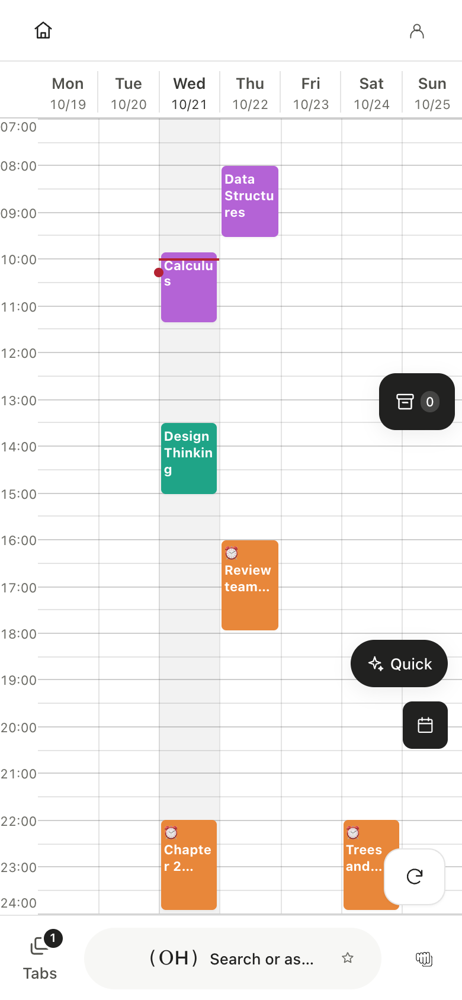
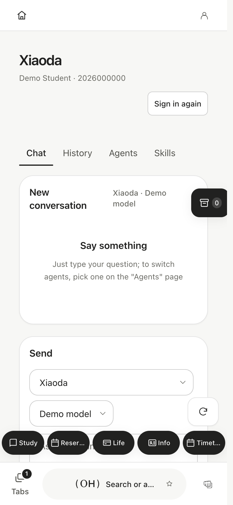
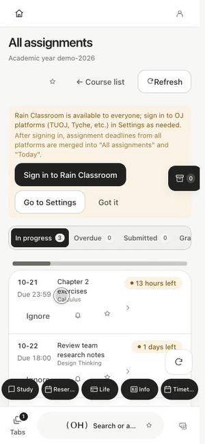

<div align="center">


**0.11.2 · Revolution**

[中文](README.md) · [English](README.en.md)

Your campus. In one place.

[Website](https://onethu.github.io/en/) · [Download](https://github.com/smartThise/OneTHU/releases/latest) · [Documentation](https://onethu.github.io/docs/en/) · [Developers](https://onethu.github.io/en/developers.html)

</div>

OneTHU is an unofficial Tsinghua campus application for macOS, Windows and Android. Version 0.11 unifies interaction with OneGUI while keeping themes, wallpapers and layouts customizable, with minimal, practical and full experience modes. Search and the OH capsule are available in all three. Full mode adds free whiteboards, staging and sharing, organizations, plugins, OneTHU Harness and Xiaoda.

## 0.11.2 maintenance update

This update improves Web Learning session recovery, includes wallpaper media in cross-device backups, respects the whiteboard editing toggle on landscape tablets, and makes glass surfaces and desktop window behavior consistent. All three modes share an update prompt with a choice of reminder delay. Available for macOS, Windows and Android. See the [release notes](docs/en/release-0.11.2.md).

## Real interface. Fictional data.

The images below are captured from the application with fictional fixtures, without real accounts or private records. They cover phone portrait, landscape and desktop layouts. The example UI is Chinese. See [capture provenance](docs/en/screenshots.md)。

<table><tr><th>Minimal</th><th>Practical</th><th>Full</th></tr><tr><td></td><td></td><td></td></tr></table>


<details><summary>Desktop, learning, schedule and Xiaoda screenshots</summary>



<table><tr><td></td><td></td><td></td></tr></table>

</details>

## What you can do in 0.11

| Capability | Details |
|---|---|
| Three modes | Minimal focuses on today’s tasks/classes; practical keeps everyday services close; full opens the complete workspace. Switching changes visibility without deleting prior configuration. |
| Unified search | Find features, services and integrated content from the OH capsule and jump directly, without a model response. |
| OneShot / OneGO / whiteboards | Five default shortcuts: Study, Reservations, Life, Information and Schedule. Full mode manages tabs, a bookmark-style bar, workspaces and movable whiteboard widgets. |
| Study and schedule | Learning-platform courses, assignments, notices and files; optional Rain Classroom/OJ sources; shared course, deadline and custom-event views across all modes. |
| Campus life and reservations | Campus card, electricity, network, news, classrooms, library and discussion-room services, subject to school systems and account permissions. |
| Staging and sharing codes | Hold an integrated item, lift it and drop it onto the highlighted staging button. Share with online short codes. NFC is currently unreliable; prefer codes. |
| Cards and organizations | Full-mode cards, friends, members/permissions, files, projects and announcements; see the docs for account ownership, synchronization and live two-account verification boundaries. |
| OH / OneTHU Harness | Full mode can use authorized tools and plugins. Compact modes retain your own API and WeChat/Feishu links. Model-service authorization and quotas are separate. |
| Xiaoda and skills | Models, agents and a skill plaza. Pure synchronous JavaScript uses bounded QuickJS; export heavier environments to an external desktop agent. Not every skill can run on a phone. |
| Plugins | JS, desktop Rust sidecars and Android embedded delivery. The generated API lists 36 namespaces and 255 method entries, subject to permissions and platform support. |

## Hold, lift, keep

The demo uses the real pickup/drop handlers with only a pointer marker added. Integrated assignments, files, widgets, tabs, workspaces, search results, events, cards, mail and cloud sources are supported; arbitrary on-screen content is not automatically collectible.



[Supported items and organization sync](docs/en/sharing-and-organizations.md)

## Install and get started

Use [Releases](https://github.com/smartThise/OneTHU/releases/latest) for platform packages, or the [cloud mirror](https://cloud.tsinghua.edu.cn/d/56f78a2a0b144a6ab737/)。Available release files are authoritative; mirrors may lag behind.

1. Choose language, then mode. Guide actions open real destinations with a return control.
2. Use university authentication and complete second-factor verification when required; mail, calendars, storage and models may require separate authorization.
3. Connect services and enable notifications as needed. Inspect redacted diagnostics rather than repeatedly forcing login refresh.

[Getting started](docs/en/getting-started.md) · [Privacy and troubleshooting](docs/en/privacy-and-troubleshooting.md) · [0.11 notes](docs/en/release-0.11.md)

## Develop and contribute

```bash
git clone --recurse-submodules https://github.com/smartThise/OneTHU.git
cd OneTHU
git switch dev3
pnpm install
pnpm dev
```

A browser preview is not the native host. Native builds need Rust and Tauri platform dependencies; Android additionally needs a JDK, SDK and NDK. The active development branch is dev3.

- [Developer center and builds](docs/en/developers.md)
- [All contributors and major contributors](docs/en/contributors.md)
- [Plugin development](docs/en/plugin-development.md) · [API](docs/en/api-surface.md) · [OneTHU Harness](https://github.com/smartThise/OneTHU-Harness)
- [Architecture](docs/en/architecture.md) · [OneGUI](docs/en/design-language.md) · [Documentation and historical status](docs/en/documentation-catalog.md)

## Credits and license

Thanks to [THU Info](https://github.com/thu-info-community/thu-info-app)、[learnX](https://github.com/robertying/learnX)、[thu-learn-lib](https://github.com/Harry-Chen/thu-learn-lib)、NextTHUxk、thu-tok-auto、yuketang-helper-auto and all contributors.

Project-owned code uses MIT with additional non-commercial and no-attack restrictions; it is not an unrestricted MIT license. THU Info authorization, LearnX exceptions and other third-party terms apply separately.

[Full license](LICENSE) · [Third-party licenses and authorization](LICENSES/THIRD-PARTY.md)
