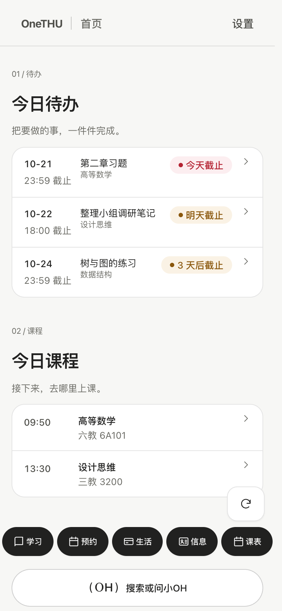
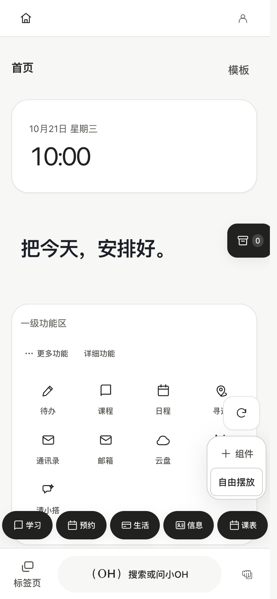
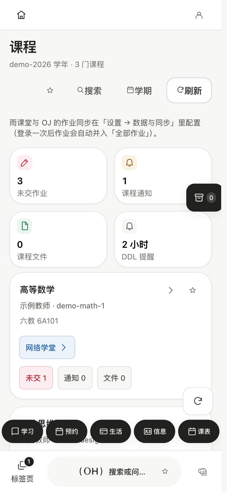
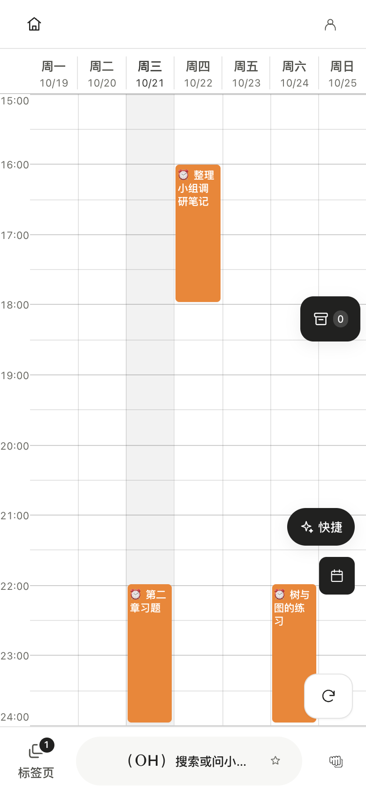

<div align="center">


**0.11.4-fix-1 · Revolution**

[中文](README.md) · [English](README.en.md)

校园万物，汇于一处。

[官网](https://onethu.github.io/) · [下载](https://github.com/smartThise/OneTHU/releases/latest) · [文档](https://onethu.github.io/docs/) · [开发者](https://onethu.github.io/developers.html)

</div>

OneTHU 是非官方的清华校园应用，覆盖 macOS、Windows 与 Android。0.11 使用 OneGUI 统一交互，主题、壁纸与布局均可调整，提供极简、实用、完整三种模式；搜索与 OH 胶囊贯穿三种模式，完整模式进一步开放自由白板、暂存分享、组织、插件、OneTHU Harness 与清小搭。

## 0.11.4-fix-1 修复

修复 Windows 登录与后台启动、首页一级和二级课程、平板设置滚动及手机卡片高度。保留 0.11.4 的现有功能，三端同步更新。 [更新说明](docs/release-0.11.4-fix-1.md)。

## 0.11.4 更新

加入独立 OneTHU CLI、SDK 与桌面常驻后台，共享登录和任务；OH 接入雨课堂、好友、组织、清小搭技能和暂存箱。修复通知附件命名、云盘自动连接与 IM 会话隔离，合入玻璃与界面优化。macOS、Windows 与 Android 同步更新，详见 [更新说明](docs/release-0.11.4.md)。

## 真实界面，模拟数据

以下图片来自应用自身的模拟数据视图，无真实账号或个人资料。包含手机竖屏、横屏与桌面；界面语言示例为中文。素材与断网检查见 [截图来源](docs/screenshots.md)。

<table><tr><th>极简</th><th>实用</th><th>完整</th></tr><tr><td></td><td></td><td></td></tr></table>


<details><summary>展开桌面视图、学习、日程与清小搭</summary>


<table><tr><td></td><td></td><td></td></tr></table>

</details>

## 0.11 可以做什么

| 能力 | 说明 |
|---|---|
| 三种模式 | 极简专注今日待办与课程；实用保留常用服务；完整开放可组织的工作空间。切换只改变显示，不删除已有设置。 |
| 统一搜索 | 从 OH 胶囊寻找功能、服务与已接入内容，直接跳转；不依赖模型生成回答。 |
| OneShot / OneGO / 白板 | 五个默认快捷入口为学习、预约、生活、信息、课表。完整模式可管理标签页、收藏栏、工作区和自由白板组件。 |
| 学习与日程 | 网络学堂课程、作业、通知、文件；按需接入雨课堂/OJ 作业；课程、截止和自定义日程合并展示，三模式均应显示可用作业截止。 |
| 生活与预约 | 校园卡、电费、校园网、新闻、空教室、图书馆及研讨间等校园服务；具体可用性依学校系统与账户权限。 |
| 暂存箱与口令 | 长按已接入内容，提起后拖入高亮暂存按钮；在线短口令分享。NFC 目前不稳定，请尽量使用口令。 |
| 名片与组织 | 完整模式提供名片、好友、成员/权限、文件、项目与公告；账户归属、同步与真实双账号联调边界见文档。 |
| OH / OneTHU Harness | 完整模式可调用已授权工具与插件；精简模式保留自填 API 和微信/飞书连接。模型服务和配额独立于校园登录。 |
| 清小搭与技能 | 模型、智能体与技能广场。纯同步 JavaScript 使用受限 QuickJS；重型环境导出给外部电脑 Agent，不能承诺所有 skill 都能在手机运行。 |
| 插件 | JS、桌面 Rust sidecar、Android 内嵌三种形态；当前 API 清单含 36 个命名空间、255 个方法入口，仍受权限与平台约束。 |

## 长按、提起、收纳

演示使用真实拖动与收纳逻辑，仅额外显示指针。支持已接入的作业、课件、白板组件、标签页、工作区、搜索结果、日程、名片、邮件、云盘等来源；不是任意屏幕内容都能拖入。


[支持范围与组织同步](docs/sharing-and-organizations.md)

## 下载与上手

从 [Releases](https://github.com/smartThise/OneTHU/releases/latest) 下载适合平台的安装包，也可使用 [清华云盘镜像](https://cloud.tsinghua.edu.cn/d/56f78a2a0b144a6ab737/)。以实际发布文件为准，镜像可能晚于发布页。

1. 先选语言，再选模式；导览动作可直达真实页面，并随时返回。
2. 使用统一认证并按需完成二次验证；邮箱、日历、云盘、模型等可能需要独立授权。
3. 按需连接服务和设置通知，遇到失败查看脱敏诊断，不要持续强制刷新登录。

[快速开始](docs/getting-started.md) · [隐私与排障](docs/privacy-and-troubleshooting.md) · [0.11 说明](docs/release-0.11.md)

## 开发与文档

```bash
git clone --recurse-submodules https://github.com/smartThise/OneTHU.git
cd OneTHU
git switch dev3
pnpm install
pnpm dev
```

浏览器预览不等同于原生宿主。原生构建需 Rust 与 Tauri 平台依赖，Android 另需 JDK / SDK / NDK。主力开发分支为 dev3。

- [开发者中心与构建](docs/developers.md)
- [OneTHU CLI、SDK 与常驻助理](docs/onethu-cli.md)：独立登录、课程归档、定时检查和 IM 通知；MCP 可供其他智能体使用。安装与验收边界见指南。
- [全部贡献者与主要贡献者](docs/contributors.md)
- [插件开发](docs/plugin-development.md) · [API](docs/api-surface.md) · [OneTHU Harness](https://github.com/smartThise/OneTHU-Harness)
- [架构](docs/architecture.md) · [OneGUI](docs/design-language.md) · [全部文档与历史状态](docs/documentation-catalog.md)

## 致谢与许可

感谢 [THU Info](https://github.com/thu-info-community/thu-info-app)、[learnX](https://github.com/robertying/learnX)、[thu-learn-lib](https://github.com/Harry-Chen/thu-learn-lib)、NextTHUxk、thu-tok-auto、yuketang-helper-auto 及所有贡献者。

自有代码采用 MIT 并附加非商业、禁止攻击清华信息服务等限制，不应视为无附加条件的 MIT。THU Info 授权、LearnX 例外和其他第三方条款分别适用。

[完整许可](LICENSE) · [第三方许可与授权](LICENSES/THIRD-PARTY.md)
