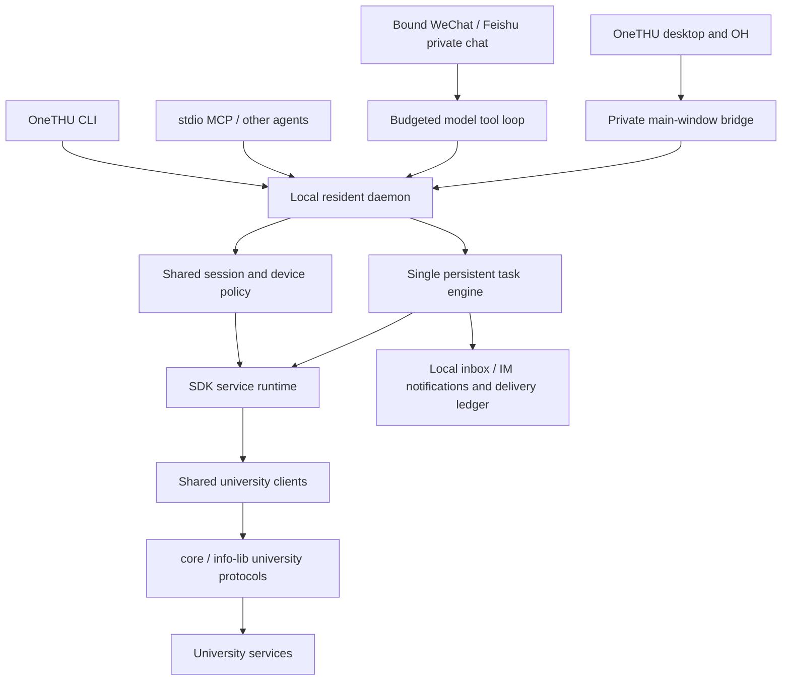

# OneTHU CLI, SDK and resident assistant

[简体中文](../onethu-cli.md) · [Installation and full command examples](../../packages/cli/README.en.md) · [SDK embedding API](../../packages/sdk/README.en.md)

Updated: 2026-10-26. This document describes the independent CLI and bundled desktop runtime in 0.11.4.

## Product layers

**OneTHU CLI** is the terminal entry point for people and other agents. **OneTHU SDK** is the embeddable runtime, and **MCP** is one of its tool protocols. The resident process runs approved tasks and IM channels continuously while the host is available. The desktop app supplies visual management and shares university clients, the Web Learning resource service, the task engine and execution policy.



The desktop, OH and default CLI connect to one local daemon and share its session, device policy, tasks and run history. Desktop packages include Node and the background program; first startup transfers existing session and task records, and approved tasks continue after the app closes. GUI service clients remain in the desktop. A private main-window bridge and durable session epochs prevent stale windows from restoring a logged-out account. `--desktop` selects graphical services; an explicit `--data-dir` creates an isolated profile.

Migration preserves task IDs, history, and download/notification deduplication records. An unconfirmed recipient or conflicting task ID leaves the original record intact and displays a pending-transfer warning; tasks already in the background remain manageable. A failed session handoff preserves the existing desktop snapshot for retry. Completion of CLI two-factor verification is observed even within the same epoch. Switching accounts or signing out cancels the previous account's active tasks.

## Capability coverage

Before calling an operation, use `onethu commands` and `onethu schema OPERATION` to inspect the actual host catalog. Independent and desktop hosts may publish different numbers of operations; a fixed count is not a compatibility contract.

| Area | Independent runtime integration | Boundaries |
| --- | --- | --- |
| Authentication | Stable device fingerprint, saved/restored sessions, SM2 login, interactive 2FA, logout | No automatic password persistence; additional university verification needs user interaction |
| Web Learning | Semesters, courses, files, assignment/announcement bodies and attachments, discussions, course archives | The full homework enumeration boundary remains explicitly uncertain; partial results are preserved |
| Campus information | Timetables, grades, exams, news, academic calendar, empty classrooms, course selection/evaluation, card/network/dorm queries | Uses existing university endpoints and pagination |
| Libraries, discussion rooms and spaces | Resources, booking records, approved bookings and cancellations | Initial email binding for discussion rooms requires the official interface; queries do not initialize it automatically |
| Sports venues | Venues, time slots, records, cancellations and official booking links | Actual booking retains the official interactive flow |
| Mail and calendars | Independent IMAP/SMTP/CalDAV configuration, read-only mail queries, approved sending/calendar changes, local calendar | Requires a mail-client authorization code; calendar updates use ETags; moves between local and cloud calendars need separate handling |
| Cloud storage | Explicit configuration, connection state, libraries/directories, search and sharing | Desktop credentials are not inherited; general upload/download is not yet exposed through CLI |
| GitLab | Projects, files, issues, comments, merge requests, pipelines and approved writes | Unknown write outcomes are not automatically replayed |
| Other services | External assignment snapshots/refresh, service-catalog search, visit-report forms/local drafts, account-local Markdown memory reads | Final visit-report submission retains the official interface; OH cloud memory needs explicit migration or separate integration |
| Plugins | Static inspection and installation of local directories/ZIPs, JS/Rust execution, commands, permissions and removal | Trusted local code with no OS sandbox; GUI/WASM capabilities explicitly report unsupported status |
| Resident assistant | Scheduled checks, incremental downloads, deadline reminders, task management, inbound/outbound IM and model tool loops | Requires an online resident process; quiet hours, independent WeChat QR login and built-in MadModel login are not available yet |

Canvas layout, dragging and application-tab operations require a graphical interface. The SDK capability catalog marks them as GUI-only.

## Independent host lifecycle

`createOneThu({dataDir})` acquires an exclusive lock on a private directory, loads local configuration and registers implemented operations. Construction and catalog inspection issue no university requests. `auth.login` explicitly authenticates and saves cookies and the device fingerprint on success; `restore` performs read-only verification of an existing session. Ordinary commands close their runtime when finished. `daemon serve` keeps it alive and starts tasks and IM.

Subsequent CLI processes using the same directory read private `daemon-access.json` and connect to a random loopback port. The service rejects browser Origin headers, malformed JSON, invalid tokens and oversized requests. Tokens are fixed-length random values compared in constant time. Raw credentials are excluded from `status`, projected service results and model catalogs. stdio MCP uses the same service router while retaining its source identity; JSON arguments cannot grant it local-configuration privileges.

macOS can register a user LaunchAgent; Windows can register a scheduled task for the current user. Checks cannot run while the machine is sleeping, shut down or disconnected. Recovery performs a single catch-up run for an overdue schedule, avoiding a burst of every missed interval after a long outage.

## Scheduling, authorization and idempotency

A task definition contains its schedule, courses/operation, output directory and notification destinations. It also records an owner account and revision. Creating, editing or resuming a task obtains continuing authorization. Execution creates an internal grant object bound to that task; ordinary JSON cannot construct one. Before actual downloads and message sends, guards recheck the account, revision, directory, resource, channel and cancellation state.

Supported schedules are intervals, daily times with a time zone, and one-off ISO timestamps. `school-watch` compares resource fingerprints and assignment deadlines, then aggregates changes. `operation` supports explicit read-only services or a restricted resource download. New results and prior snapshots are tracked separately; failed responses preserve earlier valid data. Queries allow bounded retries. General scheduled bookings and mail sends are outside this template's scope.

Pausing, removing or editing a task cancels its running older revision. Both Node and desktop native downloads receive cancellation signals. Already submitted remote actions cannot be rolled back, so history preserves partial/interrupted execution states and unknown delivery/download records for inspection. Downloads first write temporary files, validate them and publish them atomically. They reject symlinks, paths outside the approved directory and overwrites of existing files. Failure cleanup only touches files created by that attempt.

Task execution and platform delivery are recorded separately. Each outgoing request gets a durable idempotency record before dispatch. After a restart, `pending` delivery records become `unknown` and are not sent again automatically. A platform's `accepted` receipt acknowledges the request without proving that a person read it. Task channel IDs bind a fixed recipient: key rotation preserves the binding; replacing the recipient requires renewed approval of the task scope.

Each independent data directory supports up to 50 tasks. Each task retains its latest 30 runs; one run attempts at most 100 downloads. Deduplication ledgers also have size limits. University checks consume no model usage. A model is used to interpret user instructions and call registered tools.

## IM and model boundaries

WeChat uses the existing iLink protocol; Feishu uses WebSocket events and explicit send receipts. Channels bind a university account, sender and conversation, accepting private text messages only from the configured person. Messages are durably recorded before dispatch to the handler. Reconnection, duplicate pushes and process restarts do not execute the same received event again.

Commands such as `/status` and `/tasks` call services directly. Natural language uses a model loop bounded by turns, tool calls, bytes and time. Only read operations are exposed by default. A local user can select write tools and enable automatic execution. The model cannot configure credentials, run arbitrary shell commands or install plugins. Tool results are treated as external data; instructions embedded in returned pages or documents do not change authorization.

API keys, IM credentials and cookies are stored in private local files protected by permissions/ACLs, without additional encryption. Model conversations send necessary user text and tool results to the selected provider. Short memory is isolated by account and conversation, retaining bounded text and brief statuses. OH cloud memory keeps its existing storage path. Enabled desktop task-notification channels transfer their outbound credentials through the private bridge after verifying the account and recipient; inbound IM reception keeps one owner.

## References and implementation choices

The design considered Hermes' [scheduled-task internals](https://github.com/NousResearch/hermes-agent/blob/main/website/docs/developer-guide/cron-internals.md) and [scheduler](https://github.com/NousResearch/hermes-agent/blob/main/cron/scheduler.py), plus OpenClaw's [cron service](https://github.com/openclaw/openclaw/blob/main/src/cron/service.ts) and [resident automation documentation](https://github.com/openclaw/openclaw/blob/main/docs/gateway/heartbeat.md). Adopted ideas include persistent tasks, separate execution/delivery records, one catch-up run, fixed private-chat bindings and lifecycle cancellation.

This implementation does not copy source code from those projects. University protocols and IM codecs reuse OneTHU's existing modules. Scheduled university checks use deterministic templates suited to bounded query frequencies. A configured model handles planning and explanation; final operations pass through the same service router, allowing OH and external agents to use the same capabilities.

## Validation record

The independent SDK was tested with synthetic university responses for authentication, 2FA, session restoration, real file downloads, account isolation and cancellation. CLI validation used real subprocesses and isolated directories for installation, daemon startup/shutdown, protocol authentication and MCP. Task persistence was checked across runtime close/reopen. IM used local HTTP/WebSocket fixtures; the model loop used self-authored responses. These tests created no real university bookings, sent no real email/IM messages and registered no real trusted devices.

Desktop task management uses real OneGUI components. Isolated data was used for Chinese/English click checks in wide and narrow windows, covering creation, editing, pausing, history and the local inbox. Local evidence is recorded in `output/cli-task-ui-fixture/QA.md`. Earlier real course-query/download checks of the desktop companion CLI belong to a different host and do not establish successful independent login.

Remaining device/live acceptance work includes independent login to a university account, Windows installation/ACL/autostart behavior, real Feishu/WeChat bindings and the chosen model service. Scheduled tasks currently have no quiet hours or dedicated deduplicated session-expiry reminders; failures can be inspected in task history. Completing source and local packages does not set a release version or publish them automatically.

## Rain Classroom queries

Use `yuketang` for Rain Classroom and `learn` for Learn. OH exposes the built-in read-only `query_yuketang` tool; independent agents and MCP clients discover the same seven queries in the operation catalog.

Sign in to Rain Classroom with the QR-code option under Settings → Account in the desktop app. With agent consent and OneTHU CLI enabled, the app privately transfers that session to the resident CLI. Queries continue after the app closes. University authentication and Rain Classroom have separate sessions: `status.configured` reports configuration, while `courses` checks live access. Missing or expired sessions produce an explicit sign-in error.

```sh
onethu yuketang status
onethu yuketang courses
onethu yuketang contents --args '["classroom-id"]'
onethu yuketang homework --args '["classroom-id",90]'
onethu yuketang homeworkDetail --args '["classroom-id","leaf-type-id"]'
onethu yuketang leafDetail --args '["classroom-id","leaf-id"]'
onethu yuketang noticeDetail --args '["classroom-id",["notice-id"]]'
```

Use classroom IDs returned by `courses` and detail IDs returned by `contents`. The content directory includes materials, videos, homework, exams and announcements and follows available pages. An optional classroom filter avoids requesting other classrooms' logs. `homework` includes deadlines and submission status; it retains past assignments and uses a future deadline horizon set by its second argument (1–3660 days, defaulting to the configured value, usually 30). Use `["",90]` for all classrooms. Learn course IDs and Rain Classroom classroom/leaf-type/leaf IDs are separate identifiers.

Read results include `complete` and `issues`. A classroom failure preserves available results and marks the result incomplete. A repeated page reports `YUKETANG_PAGINATION_STALLED`; an expired or changed session rejects stale results. These queries never submit homework.

The independent CLI retains local `exthw.configure` session import. Prefer a protected `--args-file` to keep cookies out of shell history. Existing `exthw.*` commands remain available. If the CLI already has a different Rain Classroom session, desktop synchronization preserves it and reports a conflict; the local user can explicitly choose the session with `exthw.configure`. Cookies stay outside model-visible results and documentation.
