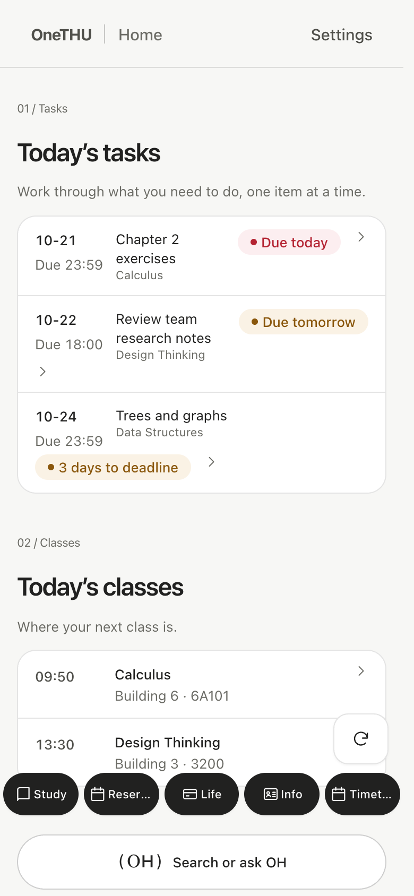
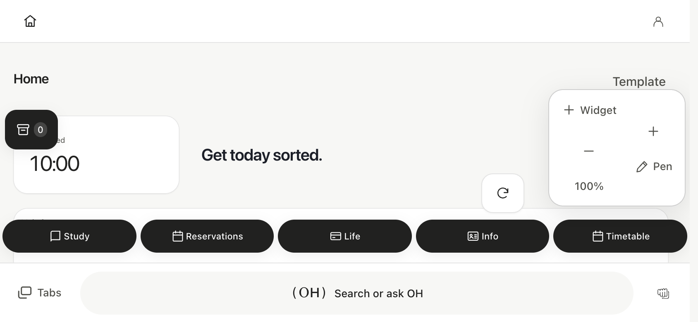

# Public screenshots and recordings

[中文](../screenshots.md) · English

Public images are captured from the real React/OneGUI interface with isolated fictional data. They are not screenshots of a real student account, and no production campus credentials are used.

The capture script installs fake cloud/organization/Xiaoda adapters, supplies example courses, assignments and user records, blocks non-local requests and uses disposable contexts. Capture provenance includes viewport and SHA-256 hashes in `docs/assets/0.11/en-US/manifest.json`. Inspect the output visually before publishing; a successful script alone does not establish readability.

```bash
# With the local Vite server already running on port 5180
ONETHU_CAPTURE_LOCALE=en-US node tools/capture-public-preview.mjs
ONETHU_CAPTURE_LOCALE=en-US node tools/capture-localized-tour.mjs
ONETHU_CAPTURE_LOCALE=en-US node tools/record-vault-onboarding.mjs
```

Viewport sets include 390×844 portrait, 844×390 landscape and 1440×900 desktop, captured through actual application components. The staging recording follows real pickup, drag and commit handlers; only a pointer marker is added. Chromium compositor calibration prevents blank side/bottom padding. The guide reuses this video on the physical phone model.

English pages and onboarding use separately captured English application screens and recordings. Chinese captures remain independent. Website WebP assets are reproducibly re-encoded from each approved language-specific capture set; no text is painted onto screenshots. Other non-Chinese app locales use the English demonstration.

{ width="260" }


