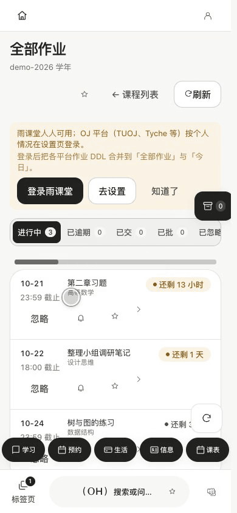

# Staging, sharing and organizations

[中文](../sharing-and-organizations.md) · English

## Hold, move, release

Long-press an integrated item until it lifts. Move it onto the highlighted staging-box button and release to collect it. Open the box to inspect the actual result. A short click opens the box; freely dragging the floating button changes its position. These gestures have separate thresholds and outcomes.

Supported integrated sources include whiteboard widgets, tabs and workspaces, OneGO items, search results, learning-platform assignments/notices/files and attachments, schedule events, name cards, mail, cloud files/folders, news, GitLab projects and integrated theme/wallpaper/plugin/settings items. Support depends on each source’s explicit drag adapter; arbitrary on-screen content is not automatically collectible. Remote files may need caching first. Desktop text-selection capture uses its dedicated shortcut where available.

## Short codes and NFC

Generate an online sharing code from the unified staging/share entry. Short codes retrieve content online; they are not base64-encoded offline copies of arbitrary files. Receiving creates an explicit preview/acceptance path. Compact modes do not receive advanced full-mode sharing.

**NFC availability is currently unreliable; prefer short codes.** Device support, foreground state and transport conditions matter. An animation is not evidence that hardware transfer succeeded.

## Cards and organizations

An organization card belongs to its created organization. Organization work includes members, roles/permissions, files, projects and announcements; cards are entry points to these objects, not independent replacement organizations. Confirm account ownership before writing remote libraries. Do not bypass an ownership failure by creating duplicate empty libraries.

Compatible cross-device changes merge automatically. A truly incompatible card or organization conflict requires an explicit choice with understandable previews. Identity, membership and file operations must enforce the real remote permissions; hiding buttons alone is insufficient. Fixture coverage does not substitute for live two-account acceptance, which remains separately tracked.
