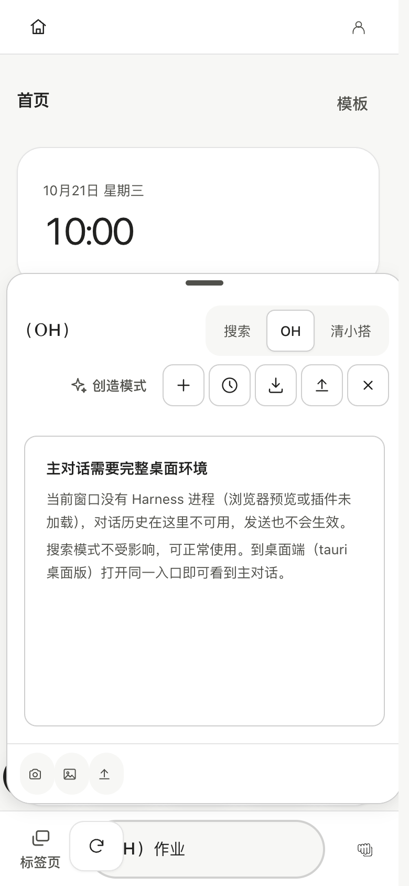
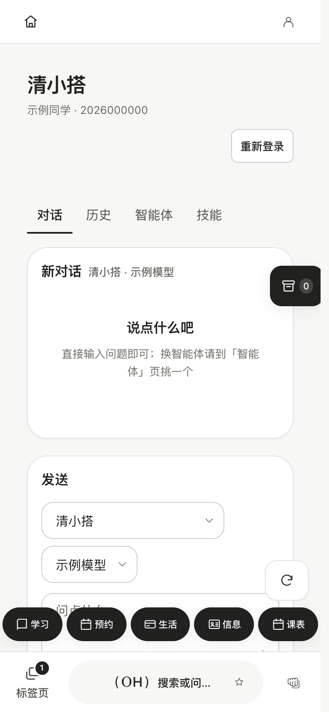

# OneTHU Harness、插件与清小搭

中文 · [English](en/oh-and-xiaoda.md)

## 搜索与 OH 的关系

胶囊内的搜索用于查找功能与校园内容；OneTHU Harness（小 OH）是可调用工具的对话入口。两者保留在三种模式中，但可用工具与设置随模式变化。精简模式保留对话、自填 API 与微信/飞书接入，完整模式提供更多模型、工具、插件与技能管理。

OH 的回答依赖当前模型与真实工具结果。模型可以提出操作，实际服务权限、账号状态和确认策略仍由宿主管理。第三方插件或技能文档不能自行授予权限。

{ width="260" }

## 模型、限流与会话

完整模式可使用已配置的学校模型源或自定义兼容 API。学校令牌有效性、校园直连与 WebVPN 可达性分别判断；HTTP 429、403、网络错误不应被当成必然需要重新提交账号密码。临时限流按 Retry-After 与退避处理，不能通过频繁刷新消除服务端限制。

API Key 只用于所选模型服务；发送的消息和工具上下文会进入该服务。隐私与诊断见 [故障处理](privacy-and-troubleshooting.md)。

## 插件

插件可提供主题、命令、功能页、数据与其他扩展，完整模式在「我的 → 插件」管理。安装后按清单授权，停用与卸载具有不同影响。原生插件、JavaScript 插件、Android 内嵌形态的运行环境不同；市场收录与实际权限校验不能替代代码审查。

完整接口清单从当前类型定义生成：**36 个命名空间、255 个方法入口**，含嵌套入口。见 [插件开发](plugin-development.md)、[API 语义](api-reference.md)、[完整声明](api-surface.md)。数量随源码变化，正文不使用旧的 30/31 命名空间统计。

## 清小搭 in OneTHU

清小搭页面集中提供对话、历史、智能体与技能广场。选择专用智能体后可新开对话；历史记录可接续。清小搭有独立的服务令牌生命周期，不能假定 OH 已接入就等于清小搭已登录。

{ width="250" }

## 轻量技能

1. 从广场导入完整技能包，检查依赖与兼容性；导入默认未启用。
2. 兼容的说明/资料与同步纯 JavaScript 技能，可手动启用给完整模式 OH。
3. 更新内容改变后重新启用。停用撤销技能索引、加载、读取与按技能运行；已有对话内容不会自动抹除。
4. Python、Node、安装器、外部服务或未知依赖整包保守标为需要电脑 Agent；桌面保存完整目录，手机导出 ZIP 后传到电脑。应用不会自动安装第三方依赖。

QuickJS 每次新建环境，限制 2 秒、32 MiB 堆、256 KiB 栈及 64 KiB 代码/输入/输出。无宿主文件、网络、进程、模块加载、环境变量或异步执行能力，不能作为 Node 环境使用。`skill_compute` 是独立的纯计算工具，不是某个已安装技能的私有权限。

OH 工具为 `skills_search`、`skill_load`、`skill_read_file`、`skill_compute`、`skill_run`；插件门面对应 `ext.skill*`。已抽查的六份真实广场包均含外部依赖，当前不能在 OH 完整运行；部分可选依赖也采用整包保守判断，未拆分其局部功能。

技能存储按本机与账号分区，未启用状态和本地技能库不做云同步。技能说明与参考资料会按工具调用发送给所选模型；owner 分区不是对被攻陷原生 IPC 的认证边界，QuickJS 也不是操作系统级进程隔离。

## 微信、飞书与 MCP

微信/飞书按设置扫码接入；桌面进程退出、设备休眠、移动系统后台限制会影响接收，不承诺云端全天常驻。QQ、企业微信与 Telegram 等研究文档是技术调研，不能作为已交付入口说明。

OH 对外提供 MCP 与连接外部 MCP 是两个方向。现有外部 stdio MCP 路由、阻塞读取超时与权限接线仍有待办，不能把任意外部 MCP 视为稳定、安全的技能执行后端。当前轻量技能使用独立的宿主方法和 QuickJS 路径，详见 [实现报告](plans/2026-10-21-xiaoda-oh-skills.md)。
