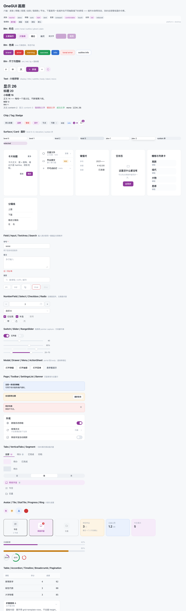
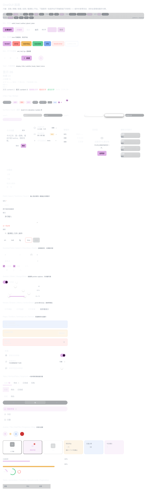

# OneGUI · 组件目录与迁移台账

> 历史记录 / Historical record：本文保留当时的计划、研究或验收证据，不代表 0.11 当前能力全集。现行说明见 [文档入口](../README.md)；英文入口见 [English overview](../en/index.md)。

> 由 `packages/gui/src/index.ts` 反解 + `tools/onegui-baseline.json` 台账生成（2026-10-14）。
> 规则原文见 [10-contract.md](./10-contract.md)，总纲见 [00-plan.md](./00-plan.md)。
> 画廊：`http://127.0.0.1:5180/?onegui-gallery=1`（可加 `&skin=glass&level=rich&scheme=dark&density=touch`）。

## 1. 六轴（唯一调度源头）

| 轴 | 取值 | 落盘 | 谁改 |
|---|---|---|---|
| skin | `neutral`（基准）/ `glass` / 注册的第三方皮肤 | `data-og-skin` | 设置页 → `director.set` |
| skinLevel | `clear` / `base` / `rich` / `deep` | `data-og-skin-level` | 设置页（仅玻璃皮肤） |
| scheme | `auto` / `light` / `dark` | `data-og-scheme` | 设置页 / 系统 |
| density | `comfortable` / `compact` / `touch` | `data-og-density` | 平台判定 + 设置 |
| motion | `full` / `reduced` | `data-og-motion` | 设置 / 系统 prefers-reduced-motion |
| platform | `desktop` / `mobile` | `data-og-platform` | `state/platform.ts` 唯一断点 |
| accent | 主题色对象 / `null` | 内联 `--og-accent*` 一族 | 主题系统（含动态取色） |

特殊要求的唯一出口：`director.defineScope(name, { "surface-1": "surface-2", radius: "lg" })` + `<Card scope=Badge>`；
可选值域受 `SCOPE_TOKENS` 白名单约束（只能指向另一个语义令牌或枚举档位）。

## 2. 组件目录（66 个，全部在画廊登记）

- `Accordion`
- `AccordionItem`
- `ActionSheet`
- `Avatar`
- `FocalImage` — 受控图片取景（焦点/缩放），供名片封面等复用
- `Badge`
- `Banner`
- `Breadcrumb`
- `Btn`
- `BtnGroup`
- `Card`
- `Checkbox`
- `Chip`
- `CodeBlock`
- `ContextMenu`
- `DataList`
- `DataRow`
- `Divider`
- `Drawer`
- `EmptyState`
- `Fab`
- `Field`
- `Grid`
- `Grow`
- `Inline`
- `Input`
- `List`
- `LoadingBlock`
- `Menu`
- `Modal`
- `NumberField`
- `Page`
- `PageHead`
- `Pagination`
- `Popover`
- `Progress`
- `Radio`
- `RadioGroup`
- `RangeSlider`
- `Ring`
- `Row`
- `SearchField`
- `Section`
- `SectionCard`
- `Segment`
- `Select`
- `SettingsList`
- `SettingsRow`
- `Sheet`
- `Skeleton`
- `Slider`
- `Spacer`
- `Spinner`
- `Stack`
- `StatTile`
- `Surface`
- `Switch`
- `Table`
- `Tabs`
- `Tag`
- `Text`
- `TextArea`
- `Tile`
- `Timeline`
- `Toolbar`
- `Tooltip`
- `VerticalTabs`

图标：`packages/gui/src/components/icons.tsx` —— 51 枚自绘线性图标整体平移（`ICONS` 注册表 + `FolderIcon`）。

## 3. 迁移台账（护栏基线，只许下调）

| 项 | 现状 | 目标 |
|---|---:|---:|
| 应用侧带外观属性的 `style={{…}}` | 660 | 0 |
| 应用侧 TSX 字面色值（#rgb/rgba） | 675 | 0 |
| 应用侧裸 `<button\|input\|select\|textarea>` | 1143 | 0 |
| `apps/desktop/src/styles/*.css` | 12,661 行 / 1,403 类 | 删除 |
| 页面里手写的旧类名（card / empty / skeleton / error-note / section-head） | 170 / 62 / 7 / 5 / 3 处 | 0 |
| `packages/ui`（旧令牌包） | tokens + base | 由 OneGUI 取代后删除 |

跑法：`pnpm guard:onegui`（迁移一批后 `node tools/onegui-guard.mjs --write-baseline` 下调基线）。

## 4. 迁移顺序（每页 = 一次提交）

1. ✅ 库：令牌 → 管线 → 布局 → 文本 → 面/卡 → 按钮 → 行/列表 → 表单 → 浮层 → 页面模式 → 展示件 → 图标 → 画廊 → 护栏
2. 🔄 壳层：`AppShell` 等外框件已入库（桌面竖栏 + 手机底部条已截图验收）；
   `Layout.tsx` 的八个旧原语（Card/Empty/SectionHead/ErrorNote/SkeletonRows/Switch/PageHead）已切成 OneGUI 适配层
   —— 60/40/28/30/8/31 个调用点一刻之间改由 OneGUI 渲染。
   `markSettingsRows()` / `focusSettingsTarget()` 改成**两族一起认**（.setting-row/.section-head 与 .og-settings-row/.og-section），
   设置搜索与直达的 UX 不受影响。**还剩**：`Layout.tsx` 外框本体（竖栏/顶栏/标签条/抽屉/设置浮层/命令面板）换 AppShell。
3. ⏳ 攻坚面：清华云盘（cloud-*）、网络学堂（作业/通知/富文本壳）、设置页 + 全部弹层
4. ⏳ 其余页面：`pages/` 全量，逐页删旧 CSS
5. ⏳ 清场：删 `apps/desktop/src/styles/*`、删 `packages/ui`、旧风格护栏由 `onegui-guard` 取代、`design-language.md` 重写为 OneGUI 手册
6. ⏳ 验收：`pnpm guard` 全绿 + typecheck + 画廊矩阵截图 + 真机走查（亮/暗/皮肤/密度/手机）

## 5. 验收证据

| 图 | 说明 |
|---|---|
|  | 基准皮肤 · 亮色 · 舒适密度 |
|  | 玻璃皮肤（rich 档）· 暗色 · 触屏密度 |
