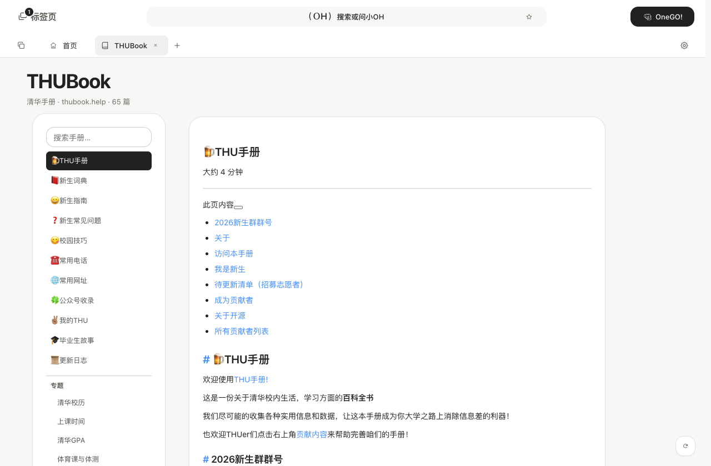

# THUBook 目录解析修复 · 2026-10-17

> 历史记录 / Historical record：本文保留当时的计划、研究或验收证据，不代表 0.11 当前能力全集。现行说明见 [文档入口](../../README.md)；英文入口见 [English overview](../../en/index.md)。


用户实录：目录标题大量重复、层级混乱。原因是旧实现把「每个分组页的**整站侧边栏**」抓回来合并进每个组——VuePress 在每一页都会重渲染完整侧边栏，按组合并的结果就是所有页面塞进所有组，标题自然重复、层级全平。

## 现在的事实源

首页 `https://thubook.help/thubook/` 的 **navbar 下拉菜单**已经包含完整两级目录：

- 根级页面：🍺THU手册 / 📕新生词典 / 😀新生指南 / ❓新生常见问题 / 😋校园技巧 / ☎️常用电话 / 🌐常用网址 / 🍀公众号收录 / ✌🏽️我的THU / 🎓毕业生故事 / 📜更新日志（11 篇）
- 分组：**专题**（33 篇）、**校内生活设施**（18 篇）、**老乡在清华**（1 篇）、**其他**（2 篇）

一次请求拿全 65 篇，层级、顺序、标签都直接来自站点。

## 解析规则（`apps/desktop/src/lib/thubookToc.ts`）

- navbar 优先：直属 `a.nav-link` = 根级页面；`.dropdown-wrapper` = 分组，`ul.nav-dropdown` 内的链接 = 组内页面。
- 路径规范化：解码 → 去 `.html` → 去 hash → 去尾部斜杠；只保留 `/thubook` 站内路径（外链「贡献内容」等排除）。
- 全局按规范化路径去重：同一页即使在根页与组内重复出现，也只保留第一次。
- 兜底：navbar 结构变化时退回侧边栏解析（组子项可能不全），不再逐页抓取合并。
- 旧错误行为已被测试钉住：侧边栏里的“全站干扰链接”不会进组。

## 页面变化

- 目录改为真正的两级：根级页面列表 + 分组标题（带分隔线）+ 组内页面（缩进）。
- 搜索同一个输入框过滤两级；分组名命中时显示整组；无匹配显示“无匹配”。
- 页头 meta 显示总篇数（`清华手册 · thubook.help · 65 篇`）。
- 翻页时路径统一走 `normalizeThubookPath`（此前同一页 `.html` / 中文编码 / hash 会产生多个缓存键）。

## 验证

- `tools/thubook-toc-test.mjs`：**12 条断言**，含纯解析（顺序/去重/规范化/外链过滤/侧边栏干扰不合并）与端到端（渲染层级、搜索、点开子页取正文）。
- 真实首页 HTML 复核：11 根页 + 4 组（33/18/1/2），总 65 篇，**0 重复路径、0 重复标题**。
- 桌面 typecheck / build 通过；真机 WebView 未复验。

## 重跑

```sh
node tools/thubook-toc-test.mjs   # Vite 需跑在 5180
```


