# OneTHU CLI、SDK 与常驻助理

[English](en/onethu-cli.md) · [安装和完整命令示例](../packages/cli/README.md) · [SDK 嵌入接口](../packages/sdk/README.md)

更新：2026-10-26。本文描述 0.11.4 的独立 CLI 与桌面内置运行时。

## 产品分层

**OneTHU CLI** 是面向人和其他 agent 的终端入口，**OneTHU SDK** 是可嵌入的运行时，**MCP** 是其中一种工具协议。常驻进程持续运行已批准的任务和 IM 通道。桌面应用提供可视化管理，并复用相同的学校客户端、网络学堂资源服务、任务引擎和执行策略。

```mermaid
flowchart TD
  CLI[OneTHU CLI] --> Daemon[本机常驻后台]
  MCP[stdio MCP / 其他 Agent] --> Daemon
  IM[绑定的微信 / 飞书私聊] --> Assistant[有预算的模型工具循环]
  Assistant --> Daemon
  GUI[OneTHU 桌面与 OH] --> Native[主窗口私有桥接]
  Native --> Daemon
  Daemon --> Session[统一会话与设备策略]
  Daemon --> Tasks[唯一持久任务引擎]
  Tasks --> Node[SDK 服务运行时]
  Session --> Node
  Node --> Shared
  Shared[共享学校客户端]
  Shared --> Core[core / info-lib 学校协议]
  Core --> School[学校服务]
  Tasks --> Delivery[本机收件箱 / IM 通知及投递记录]
```



桌面、OH 与默认 CLI 统一连接本机 daemon，共享会话、设备授权、任务与运行历史。桌面启动加载随包提供的 Node 后台，首次将既有登录和任务迁移；关闭 App 后后台继续运行。桌面保留 GUI 业务客户端，登录移交使用仅主窗口可调用的私有桥接和持久 epoch，防止旧窗口恢复已退出的账号。`--desktop` 用于图形界面服务，`--data-dir` 明确创建隔离 profile。

迁移保留任务 ID、执行历史、下载与通知去重记录。通知收件人尚未确认或任务 ID 冲突时，原始记录保持原样，界面提示待移交项目，后台已有任务仍可查看、暂停和删除。桌面接管失败会保留旧会话以供重试；CLI 的验证码流程完成后，同一 epoch 内的状态变化也会触发桌面恢复。更换账号和退出登录会取消旧账号的在途任务。

## 能力覆盖

调用前使用 `onethu commands` 和 `onethu schema OPERATION` 获取当前宿主真实目录。独立与桌面能力数量可以不同，不用固定数字推断兼容性。

| 领域 | 独立运行时已接入 | 具体边界 |
| --- | --- | --- |
| 认证 | 稳定设备指纹、会话保存/恢复、SM2 登录、交互式 2FA、退出 | 无自动密码持久化；学校额外校验需人工完成 |
| 网络学堂 | 学期、课程、课件、作业/公告正文和附件、讨论区、资料归档 | 作业全量枚举边界明确标为不确定；保留部分结果 |
| 校园信息 | 课表、成绩、考试、新闻、校历、空教室、选课/课程评价、卡/网/宿舍查询 | 沿用现有校方接口和分页 |
| 图书馆/研讨间/空间 | 资源、预约记录、批准后的预约与取消 | 研讨间首次邮箱绑定需官方交互；查询不自动初始化 |
| 体育场馆 | 场馆/时段/记录、取消、官方预约链接 | 实际预订仍走官方交互 |
| 邮箱与日历 | 独立 IMAP/SMTP/CalDAV 配置、只读邮件查询、批准后的发送/日程写入、本地日历 | 需邮箱客户端授权码；日程修改使用 ETag，跨本地/云移动需另行处理 |
| 云盘 | 显式配置、连接状态、资料库/目录、搜索、分享 | 不自动继承桌面凭据；通用上传/下载尚未接入 CLI |
| GitLab | 项目、文件、议题、评论、合并请求、流水线及批准的写入 | 写入结果未知时不自动重放 |
| 其他 | 外部作业快照/刷新、服务目录搜索、报备表单/本地草稿、账号本地 Markdown 记忆读取 | 报备最终提交保留官方交互；OH 云记忆需显式迁移或另行接入 |
| 插件 | 本地目录/ZIP 静态检查与安装、JS/Rust 运行、命令、权限与卸载 | 受信本地代码，不是操作系统沙箱；GUI/WASM 能力明确报不支持 |
| 常驻助理 | 定时检查、增量下载、DDL 提醒、任务管理、IM 入站/出站、模型工具循环 | 需常驻进程在线；尚无静默时段、独立微信扫码和内置 MadModel 登录 |

画布布局、拖拽和应用标签页等操作需要图形界面。SDK 的能力目录将它们标为 GUI 专属。

## 独立宿主的生命周期

`createOneThu({dataDir})` 获得私有目录的独占锁，加载本机配置，注册已实现的操作；构造与目录查询不会发起学校请求。`auth.login` 显式认证，认证成功后保存 Cookie 和设备指纹；`restore` 使用已有会话进行只读验证。正常命令执行后关闭运行时，`daemon serve` 持有它并启动任务、IM。

同一个目录的后续 CLI 读取私有 `daemon-access.json`，连接随机回环端口。服务拒绝浏览器 Origin、不合规 JSON、错误令牌和大请求，令牌采用定长随机值与常量时间比较。原始凭据不通过 `status`、服务结果或模型目录返回。stdio MCP 使用同一服务路由，但保留来源身份，不能通过 JSON 申请本地配置权限。

macOS 可注册用户 LaunchAgent，Windows 可注册当前用户计划任务。机器休眠、退出或断网不会被描述为“仍在监测”。任务恢复时只补一次过期周期，防止长时间离线后堆积请求。

## 调度、授权与幂等

任务定义包含调度、课程/操作、输出目录、通知对象；同时记录账号与修订号。创建、修改、恢复时取得持续授权。执行时生成进程内部的授权对象，绑定本次任务；普通 JSON 无法构造它。每次实际下载与消息发送前重新检查账号、修订、目录、资源、通道和取消信号。

当前支持 interval、带时区的 daily、一次性 ISO 时间。`school-watch` 比较资源指纹与作业截止时间，并聚合变化；`operation` 用于明确的只读服务或受限资料下载。新结果与旧快照分别保存，失败响应不会覆盖先前有效数据。查询允许少量重试；通用定时预约/发信不在该模板范围。

暂停、移除、修改任务会取消正在执行的旧版本，Node 和桌面原生下载都接收取消信号。已提交的远程操作无法回滚，因此历史会保留 partial、interrupted 或 unknown，供用户检查。资源下载先写临时文件，校验后原子发布；拒绝符号链接、越界目录和覆盖已有文件，异常清理只操作本次创建的文件。

“任务运行成功”和“通知送达平台”分别记账。每次外发在请求前保存幂等记录，重启后的 pending 记为 unknown，不自动再次投递。平台返回 accepted 代表接受请求，不代表用户已读。任务通道 ID 对接收者做稳定绑定，密钥轮换可以继续使用，更换接收者需要重新批准任务范围。

每个独立数据目录最多 50 个任务，每项保留最近 30 次执行，单轮最多下载 100 项，去重账本有大小限制。学校检查不消耗模型额度；模型用于理解用户指令和调用已登记工具。

## IM 与模型的边界

微信复用已有 iLink 协议，飞书使用 WebSocket 事件及明确回复回执。通道绑定学校账号、发件人和聊天对象，仅接收指定人的私聊文本。先持久登记消息，再交给处理器；重连、重复推送和进程重启不会重复执行同一个已接收事件。

常用 `/status`、`/tasks` 等指令直接调用服务。自然语言通过有轮数、工具数、字节和时间预算的模型循环执行。默认只暴露只读能力，本地用户可以选择写工具并开启自动执行。配置、凭据、任意 shell、安装插件等能力不会授予模型。工具结果按外部数据处理，网页和文档中的指令不能改变授权。

API Key、IM 凭据和 Cookie 使用本机私有文件及权限/ACL保护，当前未额外加密；模型对话会把所需用户文本及工具结果发送给指定提供方。会话短记忆按账号、聊天对象分开，保存有限文本及简短状态。OH 云记忆仍保留已有存储路径。桌面已启用的任务通知通道会通过私有桥接同步后台出站凭据，核验相同账号和收件人；现有 IM 入站继续保持单个所有者。

## 参考实现与选择

参考了 Hermes 的[定时任务设计](https://github.com/NousResearch/hermes-agent/blob/main/website/docs/developer-guide/cron-internals.md)与[调度器](https://github.com/NousResearch/hermes-agent/blob/main/cron/scheduler.py)，以及 OpenClaw 的[定时服务](https://github.com/openclaw/openclaw/blob/main/src/cron/service.ts)和[常驻自动化说明](https://github.com/openclaw/openclaw/blob/main/docs/gateway/heartbeat.md)。采用的思路包括任务持久化、执行与投递分别记账、单次补查、固定私聊绑定和生命周期取消。

本实现没有复制上述项目源码；学校协议和 IM 编解码复用 OneTHU 已有模块。OneTHU 的定时检查采用确定性模板，适合有限频率的学校服务查询。自定义模型负责计划和解释，最终操作经过同一个服务路由，便于 OH 和外部 agent 使用相同的能力。

## 验收记录

本轮独立 SDK 使用合成学校响应完成认证、2FA、恢复、真实文件下载、账号隔离及取消验证。CLI 用真实子进程和独立目录完成安装、daemon 启停、协议鉴权与 MCP 验证；任务持久化经过关闭/重开。IM 通过本地 HTTP/WebSocket 协议夹具验证，模型循环使用自建响应。测试不创建真实学校预约、不发真实邮件/IM，也不新增真实信任设备。

桌面任务管理使用真实 OneGUI 组件，隔离数据进行中英文宽屏和窄窗点击验收，覆盖创建、编辑、暂停、历史和本机收件箱。证据在本地 `output/cli-task-ui-fixture/QA.md`。此前桌面伴随 CLI 的真实课程查询与下载记录属于另一宿主，不作为独立登录已实测的证据。

仍需实机验证：独立学校账号登录、Windows 安装/ACL/自启动、真实飞书/微信绑定、所选模型服务。自动任务暂未实现免打扰时段与登录失效的专门去重提醒，当前失败可从任务历史查看。代码与本地包完成后仍需另行决定正式发布版本。

## 雨课堂查询（Rain Classroom / Yuketang）

雨课堂通过 `yuketang` 命名空间独立查询，网络学堂继续使用 `learn`。OH 内置工具为 `query_yuketang`；独立 Agent 和 MCP 可从目录发现相同的七项查询能力。

桌面端在「设置 → 账户 → 雨课堂」扫码登录，并授权智能体、开启 OneTHU CLI 后，已有雨课堂会话通过本机私有通道交给 CLI 后台。App 关闭后 CLI 仍可查询。学校统一认证与雨课堂分别验证；`status.configured` 表示有配置，实时可用性以 `courses` 的结果为准。未配置和会话失效会明确报错并提示登录。

```sh
onethu yuketang status
onethu yuketang courses
onethu yuketang contents --args '["课堂id"]'
onethu yuketang homework --args '["课堂id",90]'
onethu yuketang homeworkDetail --args '["课堂id","leafTypeId"]'
onethu yuketang leafDetail --args '["课堂id","leafId"]'
onethu yuketang noticeDetail --args '["课堂id",["公告id"]]'
```

`courses` 返回课堂 id；`contents` 返回课件、视频、作业、试卷、公告等目录及详情查询 id。目录逐页获取可用内容，按课堂筛选时仅拉该课堂的日志。`homework` 返回截止时间、提交状态等，保留既往作业，并取未来配置天数以内截止的作业（通常 30）；第二参数可显式设为 1–3660 天，全课堂可传 `["",90]`。不要混淆网络学堂 courseId、雨课堂 classroomId、leafTypeId 和 leafId。

读取结果带 `complete`、`issues`。部分课堂失败时保留已获取结果并标记不完整；服务端重复分页时报告 `YUKETANG_PAGINATION_STALLED`；登录失效与账号变化拒绝返回旧结果。查询不提交或修改作业。

独立 CLI 也保留 `exthw.configure` 的本机会话导入（建议用受保护的 `--args-file`，避免把 Cookie 放进命令历史）；旧 `exthw.*` 命令继续有效。如果 CLI 已配置另一份雨课堂会话，桌面同步保留它并返回冲突；可由本机用户通过 `exthw.configure` 明确指定要使用的会话。Cookie 不进入工具结果、模型或文档。
