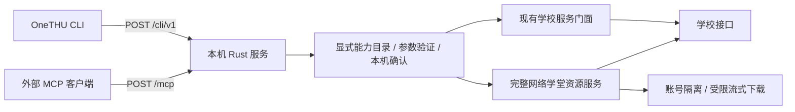

# OneTHU CLI：学校服务的命令行入口

2026-10-24。用户将原 OH MCP 连接修复与课程资料导出需求扩展为 macOS / Windows 的 OneTHU CLI。MCP 保留为接入协议，CLI、MCP 共用服务能力。MadModel 的认证修复继续独立完成。

## 架构决策

采用桌面伴随式 CLI：Node.js 20 的零依赖客户端通过回环 HTTP 调用已登录的 OneTHU，应用负责学校会话、二次验证、权限、数据解析与下载。Rust Harness 承担本机协议与桥接，不经过聊天、模型选取或 MadModel 预检。

考虑过两条其它路线：独立 CLI 再实现一套学校登录与凭据存储，会扩大跨端认证维护范围；直接包装现有 OH 摘要工具，无法满足稳定 ID、完整正文、分页和原始附件归档。伴随式的代价是调用时必须保持桌面应用运行，macOS 和 Windows 使用同一份服务代码。

## 能力与确认

- 从公共类型生成显式审核目录。新增业务方法不会自动变成对外能力；`commands` 与 `schema` 给 agent 提供实际参数契约。
- 保留学校信息、课程、成绩、课表、图书馆、研讨间、公共空间、场馆、日程、邮件、云盘、GitLab 等现有可命令化接口。场馆当前门面有查询、退订和打开官方预约页，未宣称新增自动预订。
- 读操作返回结构化结果并过滤认证字段。邮件正文用 PEEK 读取，保持未读状态。
- 预约、取消、发送、分享、改写和本地下载要求 `confirm:true`，随后由 OneTHU 本机弹窗确认具体操作与参数。拒绝并发写确认。未知结果不自动重放；GitLab 仅对原请求端点明确拒绝认证的响应恢复会话并重试一次。
- 任意网络请求、原始凭据、模型设置、存储和脚本执行入口不出现在该能力目录。

## 生命周期与隔离

默认关闭。启动激活与独立 `mcp_sync` 从受信宿主读取开关；读取失败关闭。UI 显示实际监听状态。开关关闭、撤销智能体授权、换号、宿主失联都能阻断后续请求或旧响应。

服务仅监听 loopback，拒绝浏览器 Origin、重定向和非预期路径，有请求体及超时上限。客户端只连接明确的 loopback 地址。学校 Cookie 和 Token 保留在宿主；下载通过本次会话登记的资源引用定位，客户端不能指定任意下载 URL。

## 网络学堂与归档

- 当前学期来自学校接口；课程保留 ID 和中文名称。
- 课件按服务已有的 size 参数递增枚举；公告使用 offset 翻页，包含已过期公告。重复页、总数漂移、缺 ID 和达到边界明确报未完成。
- 作业详情保留说明、提交正文及教师附件、参考答案、本人提交、批改附件；公告保留正文与附件；收集可识别的正文内联资源。
- 原生下载逐跳限制校园资源 URL，复用会话、UA 和账号代次，检测登录 HTML，流式写入、计算 SHA-256、净化 Windows 名称、不覆盖已有文件，并保护输出路径。
- `learn export` 默认只规划；执行后按中文课程目录保存正文、附件和独立 manifest。重跑先核实实际文件大小与哈希，再跳过已有资源。用户笔记保持原样。
- 当前作业三分类接口没有已验证的服务端总量协议；资源返回 `enumerationComplete:false`，导出报告明确 partial。解除这一限制需要真实接口证据，不能按收到条数假定完整。

## 验收

验证真实 CLI 子进程、HTTP / MCP、合成学校响应、完整参数验证、本机确认、并发关闭、换号迟到、分页边界、多附件、重跑复用与冲突文件。对本机开发应用再验证连接、目录和学校只读查询；macOS 的文件系统检查覆盖 APFS 与项目所在外置盘。Windows 安装与原生行为需在 Windows 主机继续验收。

实现文件、命令和当前使用边界见 [OneTHU CLI 指南](../onethu-cli.md)。本次不自动发布安装包或替换发布渠道。

## 实现收口

- 当前目录包含 119 项公共服务与 10 项网络学堂操作，核心能力使用同一会话与权限。暂未有完整提交护栏的旧云盘上传/下载与记忆写入保持 App 原入口，CLI 不公布这些方法。
- CLI/MCP 主窗口拥有唯一执行器；OH 悬浮窗口可以请求对话，但不启动 sidecar、不抢取 RPC、不承载外部命令的确认。原生进程生命周期串行化，回执绑定具体进程代次。
- 旧 MCP 工具采用逐项审查的只读兼容表，并再次通过 CLI 检查；流程、任意工具与插件执行器不再作为 MCP 捷径。
- 写入确认 45 秒到期关闭；调用总截止时间默认 110 秒、最大 150 秒，CLI 客户端把自己的超时预算传给宿主。关闭服务、撤销授权、停用插件、换号会使原请求失效。
- 下载使用同批截止时间与单调时钟预算，等待网络、写块、哈希及最终发布均检查；停止后保留成功文件并报告 remaining，未支持字节级断点续传。
- 取消预约结果不明时查询也失败，仍返回未知状态，避免把错误当空记录误报取消成功。研讨间的只读查询不自动绑定邮箱。

## 2026-10-24 本机实测结果

- 更新并重启本机 macOS dev 原生应用与 Harness，确认只有主窗口执行服务和承载确认；应用读取到正确的已登录状态。
- CLI 目录 129 项，实际读取 11 门课程；抽查一门课返回课件 5 项、作业 2 项、公告 3 项。仅记录计数，不把真实课程正文或身份数据写入报告。
- MCP 初始化、工具目录和结构化课程调用成功；共 46 项工具，包含共享服务入口和审查后的兼容只读工具。
- 主窗口批准一次课程文件下载，得到 2,847,315 字节本地文件；独立计算 SHA-256 与返回值一致，重复调用成功复用已有文件。
- MadModel 真实认证检查返回有效状态并同步模型列表；本轮没有发送付费模型对话。
- 定位作业缺失的根因：`viewCj` 只读详情页正常，`tijiao` 提交页返回 `webvpn-guide`，此前双页合并判断丢弃成功详情。新增独立 `getHomeworkReadDetail`，CLI 仅读详情页，UI 仍保留原双页提交检查。两条真实作业返回完整正文，各有教师和本人提交附件；教师附件实际下载 19,539 字节。当前作业全量边界仍未得到学校总数证明，归档会明确标记 partial。
- Windows 尚无真机验收，真实预约、发信、分享等测试写入未向学校提交。本次实现需要新版桌面构建，先前公开的 0.11.3 包没有本轮 CLI 服务。
- 最终 `pnpm test:cli` 全通过：客户端 61、服务边界 35、预约 24、窗口归属 6、其它提交守卫 6、学习服务 28、资源枚举 25，共 185 项／组；core 与 desktop 类型检查通过，i18n 中英文均为 7,594/7,594、errors 0，主仓和 Harness 的 diff 空白检查通过。Harness 另有 60 项 Rust 与 44 项真实协议检查，下载原生 14 项、窗口归属原生 2 项通过。
- 独立客户端归档 `output/onethu-cli/onethu-cli-0.11.3.tgz`，包含中英文指南及两个平台安装脚本；校验值见同目录 `.sha256` 文件。
- 共享记忆服务恢复后，整体结论已写入《OneTHU CLI 首版完成与实际验收》（checksum `19ded86c`）；本文件保留具体实现和未验收边界。
