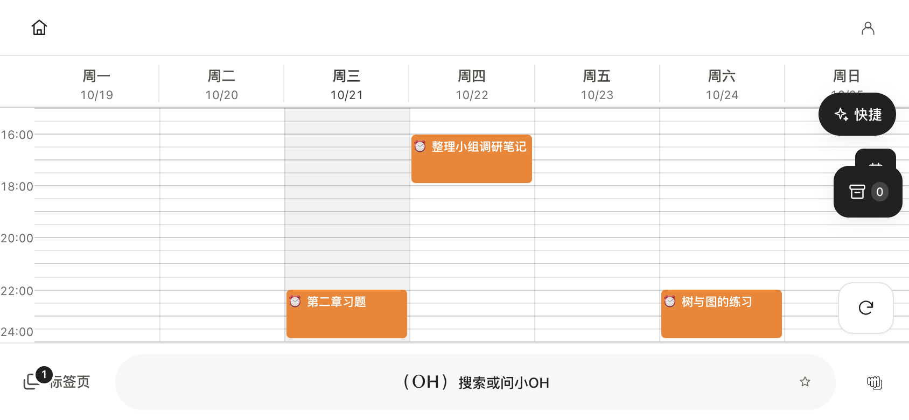

# 日程、作业截止与同步

中文 · [English](en/schedule-and-sync.md)

## 时间轴与视图

日程统一显示课程、自定义安排、考试及作业截止。列表与时间轴用于不同密度，支持日期切换与相应筛选。作业截止来自合并后的作业源；极简、实用与完整模式使用同一截止来源，不应仅在完整模式出现。

课程和作业属于不同对象。作业卡片的「前往」打开该作业标签页；课程入口可前往网络学堂课程或打开寻迹。寻迹结果依赖已知地点与当前可用地图能力，不能把未知教室位置推测成已确认坐标。

{ width="250" }

## 作业状态

网络学堂、雨课堂与已接入 OJ 的作业合并显示。忽略是本机组织行为，不能代替学校提交。已提交与已批改来自对应学校接口；上传附件、手动提交、题目详情等支持范围见 [作业区](homework.md) 和 [外部作业源](external-homework.md)。

## 日历与邮箱

| 能力 | 数据与认证 |
|---|---|
| 校内课程表 | 校园会话与学期信息 |
| 自定义安排 | 应用日程数据 |
| CalDAV / ICS | 相应日历服务与账号、授权码或订阅链接 |
| 邮件 | IMAP / SMTP 与邮箱账号、授权码 |
| 系统日历输出 | 系统权限与平台日历接口 |
| 系统通知 | 应用提醒规则与原生排程 |

日历同步、邮件同步和系统通知是不同通道；一个通道成功不代表其他通道已接入。空响应、会话错误或离线状态不应被解释为远端所有内容已删除。涉及删除的同步操作由实际协议与冲突规则处理。

## 提醒与后台

提醒按课程、考试、作业截止和自定义日程生成。自定义安排可包含重复规则；静默时段会影响投递时间。Android 的通知授权、精确闹钟与省电限制影响实际提醒。Windows 点击通知的导航能力与 macOS/Android 可能不同，以 [系统架构](architecture.md) 的平台边界为准。

列表底部内容需通过列表本身滚动到达，固定工具栏与 OneShot 不应覆盖最后几条。验收记录见 [日程布局](reviews/schedule-layout-2026-10-20/README.md)、[日历同步](reviews/2026-10-20-caldav-review.md)、[邮件同步](reviews/2026-10-20-mail-sync-acceptance.md)。这些是指定构建与测试环境的证据，不代表每个服务和设备均长期在线。
