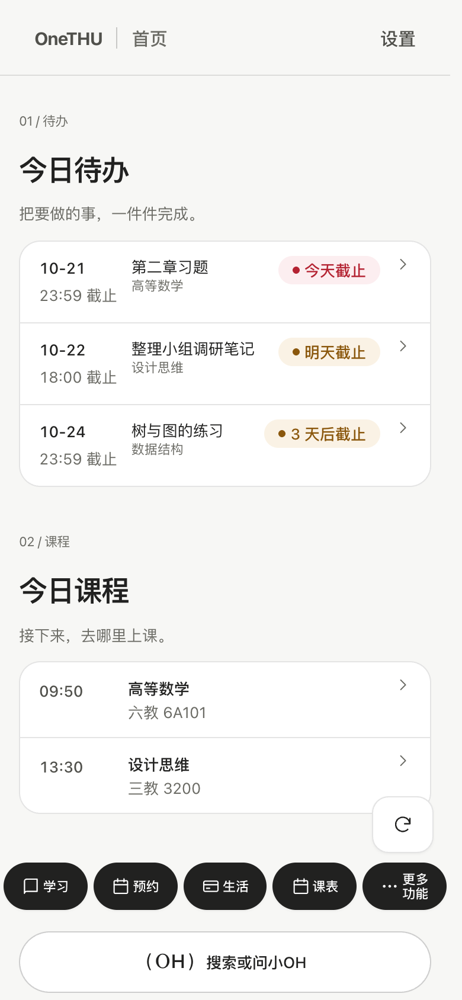
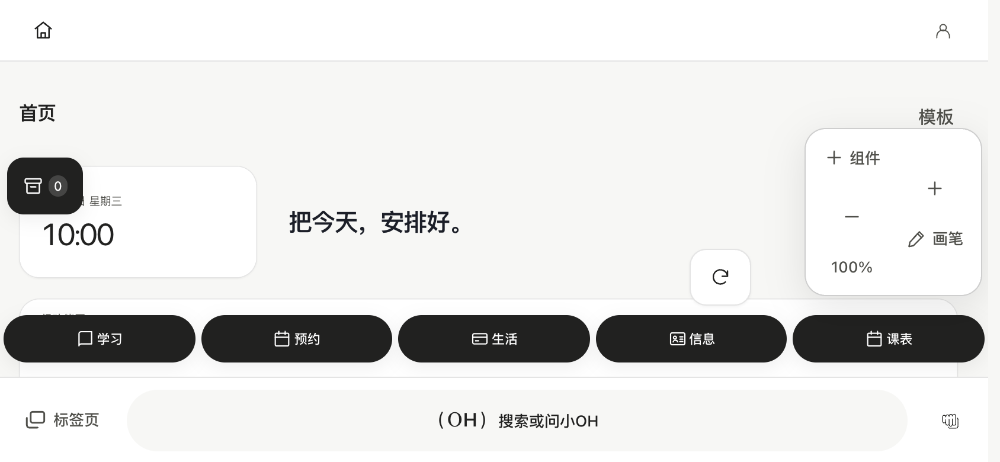
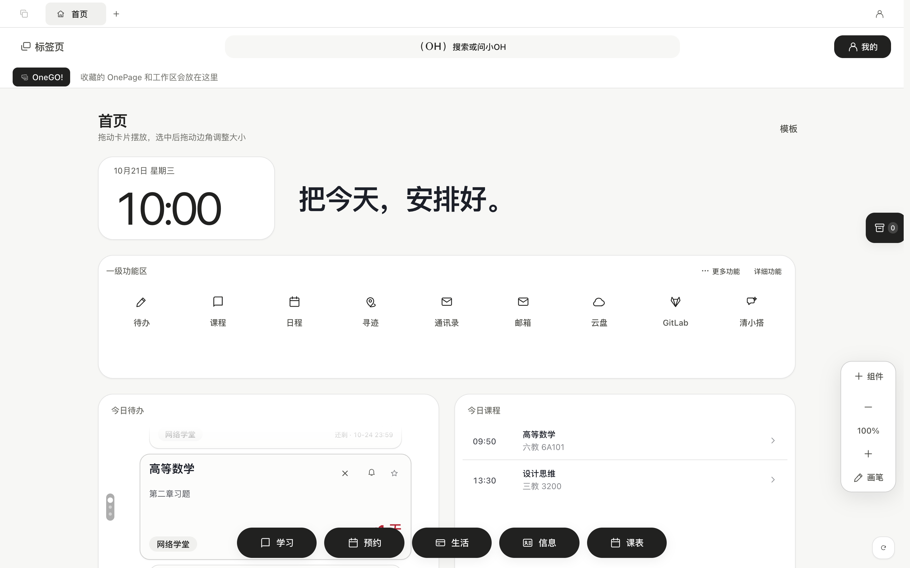

# 模拟界面与素材来源

中文 · [English](en/screenshots.md)

README、官网和用户文档中的 0.11 截图使用真实 React/OneGUI 界面与隔离模拟数据。浏览器上下文为新建临时环境，不连接用户现有浏览器或 OneTHU 原生应用；所有非本地 HTTP 请求被阻止，校园账号、个人资料和服务响应均不从真实账户读取。

## 视口

| 类型 | 视口 | 用途 |
|---|---|---|
| 手机竖屏 | 390×844，DPR 2 | 三模式、学习、日程、暂存箱、组织、搜索、OH、清小搭 |
| 手机横屏 | 844×390，DPR 2 | 首页与日程横向排版 |
| 大屏预览 | 1440×900，DPR 2 | 白板与课程布局 |

实际系统安全区、Android 后台权限、Windows WebView2 与实体触控性能不由这些截图证明。画面中的课程、人物、文件、组织、作业和服务内容均为虚构示例。

## 重现

```bash
pnpm dev
node tools/capture-public-preview.mjs
node tools/capture-common-tour.mjs
node tools/record-vault-onboarding.mjs
```

需本地 Chromium 与 Playwright，录制/格式转换另需 FFmpeg。开发服务器仅提供界面代码；模拟适配器由采集脚本注入，不进入正式包。采集过程不插入另一套产品界面，长按录制仅增加圆形指针标记。

中文素材保存在 `docs/assets/0.11/`，英文素材单独保存在 `docs/assets/0.11/en-US/`。英文官网、README、文档及导览使用英文界面与英文虚构内容重新采集的图片/视频，不在中文图片上覆盖文字；其他非中文导览语言使用英文演示。

```bash
ONETHU_CAPTURE_LOCALE=en-US node tools/capture-public-preview.mjs
ONETHU_CAPTURE_LOCALE=en-US node tools/capture-localized-tour.mjs
ONETHU_CAPTURE_LOCALE=en-US node tools/record-vault-onboarding.mjs
```

`manifest.json` 记录文件、视口、来源与 SHA-256；导览录制另有 `apps/desktop/src/assets/tour/real-ui/manifest-vault-drag.json`。官网复制同一批素材，不另行使用私人截图。重新采集后需重新核对布局与来源清单。

## 示例

{ width="260" }




